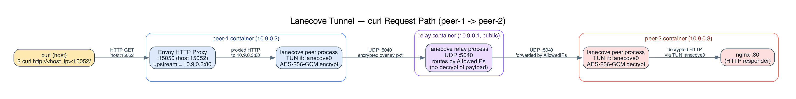

## microtunnel

[](https://github.com/jecklgamis/microtunnel/actions/workflows/build.yaml)

📖 [User Guide](https://jecklgamis.github.io/microtunnel/)

A simple Linux **hub-and-spoke layer 3 overlay network** using a TUN virtual interface over UDP. A working VPN implementation with a deliberately small feature set.

Inspired by [WireGuard](https://www.wireguard.com/), this project implements similar concepts — X25519 key exchange, identity hiding, AllowedIPs routing, and session rekeying — reimplemented from scratch in Go. It is a port of the original C implementation (`lanecove-tunnel`) and uses the same wire protocol and configuration format.

It creates a virtual IP network (`10.9.0.0/24`) layered on top of an existing underlay network, with traffic encapsulated inside UDP datagrams. Layer 3 means the tunnel operates at the IP (network) layer — it forwards raw IP packets between peers, not Ethernet frames. Each peer has a TUN interface with an IP address, and routing rules direct traffic through it. Broadcast, multicast, and non-IP traffic are not supported.

The topology is **hub-and-spoke**: peers behind NAT connect outbound to a relay with a public IP, and all traffic between peers transits through the relay. The relay forwards packets between peers in user space — no kernel IP forwarding required. Peers do not connect directly to each other (no NAT hole-punching).

```
                        ┌─────────────────────────┐
                        │  relay (public IP)       │
                        │  overlay: 10.9.0.1       │
                        │  UDP :5040               │
                        └────────────┬────────────┘
                                     │
                    ┌────────────────┴────────────────┐
                    │ UDP (encrypted)                  │ UDP (encrypted)
                    │                                  │
        ┌───────────┴──────────┐          ┌───────────┴──────────┐
        │  peer-1 (behind NAT) │          │  peer-2 (behind NAT) │
        │  overlay: 10.9.0.2   │          │  overlay: 10.9.0.3   │
        └──────────────────────┘          └──────────────────────┘
```

Peers communicate with each other via the relay — traffic from peer-1 to peer-2 travels peer-1 → relay → peer-2.

## Common Use Cases

- **Connecting peers behind NAT** — machines that can't reach each other directly (home networks, cloud VMs, mobile) communicate securely through a relay with a public IP.
- **Secure service access** — a peer runs a service (e.g. a web server or database) accessible only over the overlay IP, keeping it off the public internet.
- **Multi-site connectivity** — linking servers across different cloud providers or regions through a single relay without needing cloud VPN products.
- **Development and testing** — exposing a local dev machine's services to a remote peer (e.g. a CI runner or a colleague's machine) without port forwarding.

The relay is suited for low-to-moderate traffic between a small number of peers, not high-throughput production workloads.

## Features

### Security
- **X25519 Diffie-Hellman key exchange** — ephemeral + static key pairs for forward secrecy and mutual authentication
- **AES-256-GCM encryption** — all tunnel traffic is authenticated and encrypted
- **Identity hiding** — static public keys are encrypted inside the handshake; passive observers cannot identify peers
- **PSK authentication** — optional HMAC-SHA256 over the handshake using a pre-shared key
- **Replay protection** — 2048-bit sliding window per session rejects replayed or reordered packets
- **AllowedIPs routing** — enforces a per-peer IP allowlist; packets with unexpected source IPs are dropped
- **Session rekeying** — peers re-handshake every 3 minutes, rotating the session key automatically
- **DoS mitigations** — 5-second handshake cooldown per address and per public key

### Limitations
- **Linux and macOS** — Linux uses `/dev/net/tun`, macOS uses a `utun` device (see [Running on macOS](#running-on-macos)). Windows and BSD are not supported. The whole test suite runs natively on both, since the tests use in-memory TUN devices
- **IPv4 only** — TUN packets are validated as IPv4; IPv6 and non-IP traffic are dropped
- **UDP transport** — no packet ordering guarantees; packet loss is not retransmitted
- **Single-process** — a configurable pool of worker goroutines (`worker_threads`, default `min(4, nproc)`) parallelizes packet crypto across cores, but it's still one process per peer/relay with no multi-host failover
- **Not audited** — not hardened for production use

## Requirements

**To run:** Linux with `iproute2` (for the helper script that creates the TUN interface), or macOS 12+ (no extra tools; see below). The binary is a static Go executable — no OpenSSL, libyaml or libc version requirements. `openssl` is only needed by the key-generation scripts.

**To build:** Go 1.26+ and `make`. Docker is optional (image builds, running the tests on Linux, local end-to-end testing).

```
sudo apt install iproute2 make openssl   # plus Go 1.26+ from https://go.dev/dl/
```

## Running Natively (Linux)

Each peer runs on its own Linux host (or its own network namespace/VM). Running relay + both peers as bare native processes side by side on **one** host does not work: once `10.9.0.2` and `10.9.0.3` are both assigned to interfaces on the same machine, the kernel treats them as local addresses and any reply generated on one TUN device gets routed straight back via `lo` instead of going out that device to be re-encrypted — the tunnel never sees the return traffic, no matter how ports/interfaces/configs are set up. This isn't specific to microtunnel; the same thing happens with WireGuard or any other TUN-based overlay if you assign multiple overlapping-subnet addresses on one host's routing table. For same-machine local testing, use [Running With Docker](#running-with-docker) below, which gives each peer its own network namespace via a container.

**1. Install dependencies** (all three hosts)
```bash
sudo apt install iproute2
```

**2. Build** (once; copy the static `microtunnel` binary to the other hosts — it can be cross-built, e.g. `GOARCH=arm64 make build`)
```bash
make all
```

**3. Copy keys and config, create the TUN interface, and edit `endpoint:` — each host only needs its own peer's files.** Assume the relay's public/reachable address is `203.0.113.10`.

**On the relay host:**
```bash
sudo mkdir -p /etc/microtunnel
sudo cp config/relay.key config/relay.yaml /etc/microtunnel/
sudo ./scripts/create-tunnel.sh microtunnel0 10.9.0.1/24
sudo ./microtunnel -c /etc/microtunnel/relay.yaml
```

**On the peer-1 host:**
```bash
sudo mkdir -p /etc/microtunnel
sudo cp config/peer-1.key config/peer-1.yaml /etc/microtunnel/
sudo ./scripts/create-tunnel.sh microtunnel0 10.9.0.2/24 10.9.0.0/24
# edit /etc/microtunnel/peer-1.yaml: peers[0].endpoint: 203.0.113.10:5040
sudo ./microtunnel -c /etc/microtunnel/peer-1.yaml
```

**On the peer-2 host:**
```bash
sudo mkdir -p /etc/microtunnel
sudo cp config/peer-2.key config/peer-2.yaml /etc/microtunnel/
sudo ./scripts/create-tunnel.sh microtunnel0 10.9.0.3/24 10.9.0.0/24
# edit /etc/microtunnel/peer-2.yaml: peers[0].endpoint: 203.0.113.10:5040
sudo ./microtunnel -c /etc/microtunnel/peer-2.yaml
```

**4. Test** (from the relay host)
```bash
ping 10.9.0.2   # relay → peer-1
ping 10.9.0.3   # relay → peer-2
```

---

## Running on macOS

The binary runs natively on macOS (Apple silicon and Intel) using a `utun` device. Creating one requires **root**, so run it with `sudo`.

macOS differs from Linux in two ways, both handled by config:

- Tunnel devices are named `utunN` and the kernel picks the next free one, so set `interface: utun` (a specific `utun5` also works; any other name is ignored and the kernel chooses).
- A utun device only exists once the process has opened it, so the helper script `create-tunnel.sh` cannot pre-create it. Instead the program configures the interface itself: set **`tunnel_address`** (this Mac's overlay IP, e.g. `10.9.0.4/24`) and optionally **`tunnel_routes`** (extra CIDRs to route through the tunnel). The overlay subnet is routed automatically, and the interface MTU is set to 1428. These two keys also work on Linux.

A Mac is a regular peer (behind NAT, dialing out to the relay):

```bash
brew install go                      # Go 1.26+
git clone git@github.com:jecklgamis/microtunnel.git && cd microtunnel
make host                            # builds ./microtunnel for this Mac  (`make macos` builds arm64 + amd64 into build/)

# 1. Generate this Mac's key pair (openssl: `brew install openssl` if needed)
cd config && ../scripts/generate-peer-keys.sh my-mac && cd ..
./scripts/extract-pubkey-hex.sh config/my-mac.crt   # give this hex key to the relay's operator

# 2. On the relay, add the Mac as a peer:
#      - public_key: <hex from above>
#        allowed_ips: [10.9.0.4/32]

# 3. Copy config/peer-macos.yaml, fill in the relay's public key, endpoint and PSK,
#    point private_key_file at config/my-mac.key, then:
./scripts/run-macos.sh my-mac.yaml   # runs `sudo ./microtunnel -c my-mac.yaml`
```

Check it from another terminal:

```bash
ifconfig | grep -A3 utun            # your tunnel interface with 10.9.0.4
netstat -rn | grep 10.9.0           # route for 10.9.0.0/24 via that utun
ping 10.9.0.1                       # the relay
```

Notes:
- If the Mac is also the machine hosting the relay for local experiments, use [Docker](#running-with-docker) instead; running relay and peers on one host doesn't work for the reason given under [Running Natively](#running-natively-linux).
- macOS may show a prompt to allow incoming network connections for the binary the first time; allow it if you run an inbound-only peer.
- The utun device code can't be covered by the automated tests (they need root); the framing, interface-name, command-generation and config logic are unit-tested, and the Linux equivalent is verified in Docker. Please report anything odd on real hardware.

---

## Dynamic Peers (no restarts)

A relay normally lists every peer in its YAML, and editing that means a restart that drops every session. Instead, point the relay at a directory with **`peers_dir`** and manage peers with the built-in CLI. A running relay notices changes within a second or two, and **sessions of unaffected peers are never interrupted**.

```yaml
# relay.yaml
interface: microtunnel0
private_key_file: relay.key
pre_shared_key: some-psk
tunnel_address: 10.9.0.1/24     # the overlay subnet peers are allocated from
peers_dir: peers.d              # relative paths are resolved against this file's directory
# `peers:` is now optional; inline peers and peers_dir peers can be mixed
```

```bash
mkdir peers.d                   # once

# Recommended: the new machine makes its own key, so its private key never leaves it
microtunnel keygen laptop                      # on the laptop: writes laptop.key/.crt, prints the public key
microtunnel peer add laptop -c relay.yaml -public-key <hex> -endpoint relay.example.com:5040
#   -> picks the next free overlay IP (10.9.0.2), writes peers.d/laptop.yaml,
#      and prints a ready-made config for the laptop; save it there as laptop.yaml

# Or let the relay admin create everything (bundle of .key, .crt and .yaml to copy over)
microtunnel peer add phone -c relay.yaml -generate -key-dir ./phone -endpoint relay.example.com:5040

microtunnel peer list   -c relay.yaml          # name, allowed IPs, key, source (peers_dir or config)
microtunnel peer remove laptop -c relay.yaml   # cut off immediately
```

What a reload does (also triggered by `kill -HUP <relay pid>`, which re-reads the whole peer list):

| Change | Effect |
|--------|--------|
| peer added | becomes known at once: accepted when it connects (or dialed, if it has an `endpoint`) |
| peer removed | its session and any pending handshake are dropped immediately; its packets are discarded and its next handshake is rejected |
| `allowed_ips` changed | applied to the live session straight away, with no re-handshake |
| `endpoint` changed | re-resolved and used for the next dial; a handshake in flight to the old address is cancelled |
| anything else in the main config | needs a restart (reload only touches peers) |

A peer file holds one peer, using the same keys as an entry of `peers:`:

```yaml
# peers.d/laptop.yaml  (the file name is the peer name)
public_key: <hex>
allowed_ips: [10.9.0.2/32]
endpoint: host:port        # optional, only for peers the relay should dial
```

Safeguards: a file that fails to parse, or a duplicate public key, makes the whole reload fail and **the previous peer set keeps running** (the error is logged). The CLI writes files atomically, never overwrites an existing key, refuses an IP that is already taken or outside the subnet, and a peer's spoke config is created with `reconnect_interval: 5` so a freshly added peer connects within seconds even if it starts before the relay has noticed it. The 64-peer limit still applies.

Verify it end to end with real TUN devices: `make dynamic-test` (relay starts empty, adds alice and bob, alice and bob ping each other through the relay, alice is removed and cut off, and the relay process is shown never to have restarted).

---

## Running With Docker

**Setup (once):**
```bash
make image
```

**Local testing (all on one machine — 3 terminals):**

All three containers join a shared `microtunnel-net` Docker network; the peer scripts resolve the relay by its container name automatically, so no config editing is needed for this local flow.

```bash
./scripts/run-relay-in-docker.sh
./scripts/run-peer-1-in-docker.sh
./scripts/run-peer-2-in-docker.sh
```

**Testing the tunnel:**
```bash
./scripts/test-tunnel-using-peer-1.sh       # ping + curl peer-2 from peer-1
./scripts/test-tunnel-using-peer-2.sh       # ping + curl peer-1 from peer-2
./scripts/test-tunnel-relay.sh              # ping + curl both peers from relay
```

### Port Mapping

| Service | Container port | relay host | peer-1 host | peer-2 host |
|---------|---------------|------------|-------------|-------------|
| UDP tunnel | 5040 | 5040 | 5042 | 5043 |
| nginx | 80 | — | — | — |
| Envoy TCP proxy | 15040 | — | 15042 | 15043 |
| Envoy HTTP proxy | 15050 | — | 15052 | 15053 |
| Envoy admin | 9901 | 9901 | 9902 | 9903 |

### Envoy Proxy

Each peer container includes an [Envoy](https://www.envoyproxy.io/) proxy. When `ENVOY_UPSTREAM_HOST` is set, Envoy starts and forwards connections to the configured upstream.

Two listeners:

| Listener | Port | Mode |
|----------|------|------|
| TCP proxy | 15040 | L4 pass-through |
| HTTP proxy | 15050 | L7 with connection pooling (~130 req/connection) |
| Admin | 9901 | HTTP stats |

```bash
curl http://localhost:15052   # HTTP proxy through peer-1 → peer-2's nginx
curl http://localhost:15042   # TCP proxy
curl http://localhost:9902/stats  # Envoy admin
```

### Docker Environment Variables

| Variable | Default | Description |
|----------|---------|-------------|
| `TUNNEL_NAME` | `microtunnel0` | TUN interface name |
| `PEER_IP` | `10.9.0.1/24` | This peer's overlay IP/CIDR |
| `PEER_ROUTES` | _(none)_ | Space-separated extra CIDRs to route via TUN |
| `PEER_CONFIG` | `peer.yaml` | Path to YAML config file inside container |
| `ENVOY_UPSTREAM_HOST` | — | Upstream host for Envoy; if unset, Envoy is not started |
| `ENVOY_UPSTREAM_PORT` | `80` | Upstream port for Envoy |

## Development

```bash
make test               # unit + in-process end-to-end tests, natively (no root, TUN device or Docker needed)
make test-race          # same, with the race detector
make check              # gofmt check + go vet (macOS and Linux) + race tests
make test-using-docker  # run the race-detector suite on Linux in a golang container
make integration-test   # full test with real TUN devices: relay + 2 peers in Docker, ping + curl
make dynamic-test       # real-TUN test of `peers_dir` + `microtunnel peer add/remove` against a running relay
make all                # build the static ./microtunnel binary (linux, host architecture)
make host               # build ./microtunnel for the machine you're on (use on macOS)
make macos              # build macOS binaries (arm64 + amd64) into build/
make image              # build the Docker image (microtunnel-peer:latest)
make deb | make rpm     # build packages (DEB_ARCH=amd64|arm64, RPM_ARCH=x86_64|aarch64)
```

Layout:

| Path | Contents |
|------|----------|
| `cmd/microtunnel` | `main`: flags, config loading, signal handling, wiring; `peer add/remove/list` and `keygen` subcommands |
| `internal/proto` | wire protocol: AES-256-GCM data packets, X25519 handshake with identity hiding, session-key derivation, 2048-bit replay window |
| `internal/config` | YAML config parsing/validation, CIDR parsing, `peers_dir` loading |
| `internal/admin` | the logic behind `microtunnel peer add/remove/list`: IP allocation, peer files, spoke-config generation |
| `internal/peer` | session table, AllowedIPs routing, worker goroutines, handshake state machine, housekeeping (rekey/expiry/keepalive), live peer reload (`reload.go`, `watch.go`) |
| `internal/tun` | TUN devices: Linux `/dev/net/tun`, macOS `utun`; optional interface address/route setup |
| `internal/logx` | timestamped logger |

The `peer` tests run complete relay/peer topologies inside one process over loopback UDP with in-memory TUN devices, so rekeying, expiry, roaming and spoofing are all exercised without privileges.

## Request Path

Example request path for `curl http://<host_ip>:15052` against peer-1, routed through the tunnel to peer-2's nginx:



## Security Details

### Handshake Flow

```
INITIATOR (peer-1)                             RESPONDER (relay)
──────────────────                             ─────────────────

Generate eph_c keypair
Encrypt static_pub_c with
  SHA-256(DH(eph_c, static_pub_s))
Compute HMAC-SHA256(psk, ...)

  ──── HANDSHAKE INIT ────────────────────────────>
       [8 magic]
       [32 eph_pub_c]
       [48 AES-GCM(static_pub_c)]
       [32 HMAC(psk)]  (if PSK)

                                                Verify HMAC (if PSK)
                                                Decrypt static_pub_c
                                                  using DH(eph_c, static_s)
                                                Look up peer config by static_pub_c
                                                Generate eph_s keypair (pre-generated)
                                                Encrypt static_pub_s with
                                                  SHA-256(DH(eph_s, eph_c))
                                                Derive session key (see below)
                                                Save old key as prev_key (90s grace)
                                                Reset replay window
                                                Pre-generate next eph keypair

  <─── HANDSHAKE RESPONSE ────────────────────────
       [8 magic]
       [32 eph_pub_s]
       [48 AES-GCM(static_pub_s)]
       [32 HMAC(psk)]  (if PSK)

Verify HMAC (if PSK)
Decrypt static_pub_s
  using DH(eph_s, eph_c)
Verify static_pub_s matches config
Derive same session key
Save old key as prev_key (90s grace)
Reset replay window, send_seq=0

  ──── DATA (AES-256-GCM, seq=1) ─────────────────>
  <─── DATA (AES-256-GCM, seq=1) ─────────────────
```

Both sides retain the old session key for 90 seconds (`prev_key` grace period) to decrypt in-flight packets during the switchover. Prev-key packets bypass the replay window to prevent old sequence numbers from poisoning the new session.

### Handshake Wire Format

```
[8 magic][32 eph_pub][48 AES-256-GCM(static_pub)][32 HMAC-SHA256(psk,...)]?
```

### Session Key Derivation

```
SHA-256(
  DH(eph_c, eph_s)        ||
  DH(static_c, eph_s)     ||
  DH(eph_c, static_s)     ||
  client_eph_pub          ||
  server_eph_pub          ||
  client_static_pub       ||
  server_static_pub
)
```

### Data Packets

```
[12-byte IV][AES-256-GCM ciphertext of (8-byte magic + 8-byte seq + payload)][16-byte GCM tag]
```

Magic is `0xdeadbeefcafebabe`. Packets with a bad magic header, invalid GCM tag, or replayed sequence number are silently dropped.

## Comparison with Alternatives

| | **microtunnel** | **WireGuard** | **OpenVPN** | **IPsec (strongSwan)** | **GRE** | **Tinc** |
|---|---|---|---|---|---|---|
| **Layer** | L3 (TUN) | L3 (TUN) | L3/L2 (TUN/TAP) | L3 | L3 | L2/L3 |
| **Transport** | UDP | UDP | UDP/TCP | ESP/UDP | IP proto 47 | UDP/TCP |
| **Topology** | Hub-and-spoke | Mesh or point-to-point | Hub-and-spoke or mesh | Point-to-point or mesh | Point-to-point | Mesh |
| **Key exchange** | X25519 (custom) | X25519 (Noise protocol) | TLS (RSA/ECDSA) | IKEv2 (RSA/ECC) | None | Ed25519 |
| **Encryption** | AES-256-GCM | ChaCha20-Poly1305 | AES-256-GCM | AES-256-GCM | None | AES-256-GCM |
| **Identity hiding** | Yes | Yes | No | No | No | No |
| **NAT traversal** | Yes (outbound peers) | Yes | Yes | Partial (NAT-T) | No | Yes |
| **Replay protection** | Yes (2048-bit window) | Yes | Yes | Yes | No | Yes |
| **PSK support** | Yes | Yes | No | Yes | No | No |
| **Rekeying** | Every 3 min | Every 3 min (180s) | Configurable | IKEv2 rekeying | No | No |
| **Kernel module** | No (userspace) | Yes | No (userspace) | Partial (xfrm) | Yes | No |
| **IPv6 support** | No | Yes | Yes | Yes | Yes | Yes |
| **Platforms** | Linux, macOS | Linux, macOS, Windows, BSD | Cross-platform | Cross-platform | Linux | Cross-platform |
| **Throughput** | Low-medium (userspace, multi-goroutine) | High (kernel) | Medium | High (kernel) | High (kernel) | Medium |
| **Lines of code** | ~2,100 (Go) | ~4,000 (kernel) | ~100,000+ | ~500,000+ | — | ~50,000 |
| **Purpose** | Simple/small-scale | Production | Production | Production | Infrastructure | Mesh VPN |

---

## Security Review

The original C implementation was reviewed for memory safety, injection vulnerabilities and cryptographic correctness; no high-confidence exploitable vulnerabilities were found. The Go port has **not** been independently audited. Notes carried over from that review:

| Finding (C implementation) | Status in the Go port |
|---------|------------------------|
| `strcpy()` after TUNSETIFF ioctl, unbounded `sprintf()` in `bytes_to_hex()` | No longer applicable — Go is memory-safe, and the TUN name goes through `unix.Ifreq` |
| Unquoted `${PEER_ROUTES}` expansion in `scripts/docker-entrypoint.sh` | Unchanged; false positive — intentional word-splitting of a trusted operator-set Docker env var; no untrusted input path |
| `TUNNEL_NAME` in sysctl command in `scripts/create-tunnel.sh` | Unchanged; false positive — always hardcoded or set by the container operator who already has root |

Cryptography uses only the Go standard library (`crypto/ecdh` X25519, `crypto/aes` + GCM, `crypto/hmac`, `crypto/sha256`). X25519 results that are all-zero (low-order peer points) are rejected, and HMAC and identity comparisons are constant-time.

### Behavior differences from the C implementation

The wire protocol and YAML format are unchanged. The port deliberately tightens a few behaviors:

- **Keepalive/expiry:** only authenticated, non-replayed packets refresh a session's idle timer. (The C code refreshed it for any datagram from the peer's address, so spoofed junk could keep a dead session alive.)
- **Non-IPv4 payloads** received from a peer are dropped. (The C code passed them to the TUN device without applying the AllowedIPs source check.)
- **Simultaneous-rekey tie-break** now works when both sides dial each other. (In C, a peer's initiation arriving from the address we had dialed was classified as a failed *response*, so the "higher public key wins" branch was unreachable there.) A forged packet can no longer cancel a pending handshake.
- **Unknown peers get no reply:** the responder checks the initiator's identity *before* answering the handshake.
- **DNS** re-resolution no longer happens while holding the session-table lock.
- **Dynamic peers** (new): `peers_dir`, hot reload (`SIGHUP` or automatic), and the `peer`/`keygen` subcommands have no C equivalent. Duplicate peer public keys are now rejected.
- **Config:** an empty `pre_shared_key`, a peer without `public_key`, and interface names longer than 15 characters are rejected instead of being silently accepted.

---

## References
* https://www.kernel.org/doc/Documentation/networking/tuntap.txt
* https://www.wireguard.com/papers/wireguard.pdf
